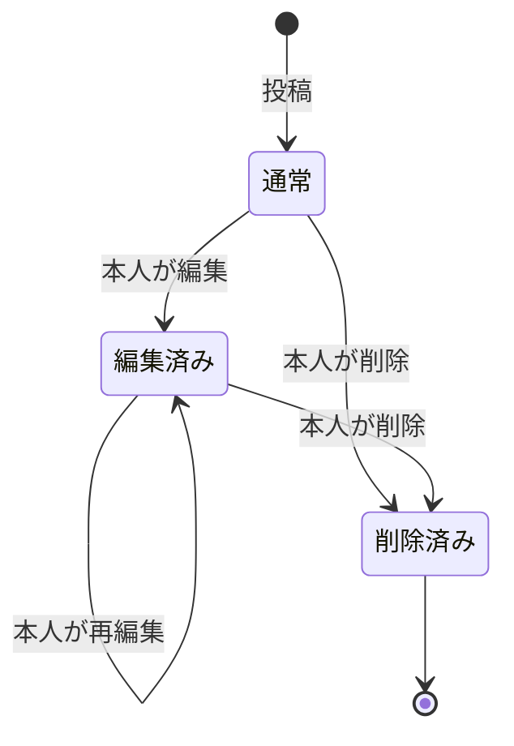
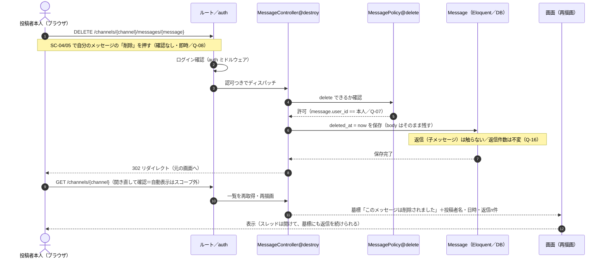

# 振る舞い設計（状態遷移・シーケンス・例外方針）

`docs/spec.md`（仕様書）・`mockup/`・確定した `docs/design/`（`features.md`・`questions.md`・`screens.md`・`data.md`・`permissions-api.md`）をもとにした、動きの設計です。**メッセージの状態遷移図・代表的な処理のシーケンス図・例外方針** を置きます。

- 図は Markdown 内の Mermaid で書きます（README「そのほかの決まり」）。
- 根拠は spec・mockup・`docs/design/` にあるものだけに限り、書かれていないことは想像で足していません。
- 権限の 403／404 の使い分けは `permissions-api.md` の Policy と対になります。HTTP の扱いもそちらと揃えています。

---

## 0. クラス図は作りません（MVC の形に乗せる）

**クラス図は描きません。** この設計は Laravel の MVC の標準の作りに素直に乗せます（Eloquent モデル＝テーブル1枚＝`data.md` の4表、コントローラ＝`permissions-api.md` のルート表、画面＝Blade ／ `screens.md`）。README「書く量の決まり」のとおり、この1行を決めれば足ります。

---

## 1. 状態遷移図（メッセージ）

対象は **メッセージ1件**（直下・返信を問わず `messages` の1行）です。状態は `edited_at`・`deleted_at` の有無で決まります（`data.md` §2-4）。

| 状態 | DB上の見分け | 画面の見せ方 | 遷移のきっかけ |
|:--|:--|:--|:--|
| 通常 | `edited_at` が `NULL`・`deleted_at` が `NULL` | 本文をそのまま表示 | F-10 投稿／F-13 返信で作られる |
| 編集済み | `edited_at` が非 `NULL`・`deleted_at` が `NULL` | 本文末尾に小さく「編集済み」（design-guide §4） | F-11（本人のみ・Q-07）。時間制限なし・印は付いたまま（回答ログ） |
| 削除済み | `deleted_at` が非 `NULL`（本文は保持） | 本文の代わりに墓標「このメッセージは削除されました」。投稿者名・日時・返信件数は残す（design-guide §4） | F-12（本人のみ・確認なしで即時＝Q-08） |

- **削除済みは終端**です。本人でも再編集・再削除はしません（`permissions-api.md`：墓標への `update`/`delete` は 403）。
- 削除しても**返信は消えません**。返信件数も残り、**墓標にも返信を続けられます**（spec 3-4／Q-16／回答ログ）。返信の投稿は別のメッセージ行が増えるだけで、この行の状態は変わりません。
- 編集・削除はメッセージを「直す／跡を残す」操作で、チャンネルごと消す F-07（物理削除・墓標を残さない）とは別の決まりです（Q-08／`data.md` §3）。

---

## 2. シーケンス図（代表1本）

README「書く量の決まり」のとおり**代表を1本だけ**描きます。題材は **「スレッドの返信が付いたメッセージを、書いた本人が削除したとき」**（F-12＋F-13 の絡み）。削除は論理削除で、返信・返信件数が残ることを示します。

- 削除は **論理削除**（`deleted_at` を立てるだけ）。本文も投稿者も日時も行ごと残り、墓標＋返信件数を出せます（`data.md` §0・§2-4）。
- 新着の自動反映はスコープ外（spec 4）なので、結果の確認は**開き直し**（再取得）で表現しています。
- 他人がこのメッセージを削除しようとした場合は、ステップ⑤で `P` が拒否し **403**（`permissions-api.md`）。本シーケンスは本人のケースです。

---

## 3. 例外方針

「正しく操作しなかったとき／権限がないとき／入力が不正なとき」に、どう返すかの方針です。画面（web）と 公開API（JSON）で返し方を分けます。

### 3-0. いちばん大事な原則：403 と 404 の使い分け

**見られないプライベートチャンネルに関わる失敗は、すべて 404 にします**（「そういう部屋がある」こと自体を隠す。Q-01）。権限の有無を 403 で区別すると、存在が漏れるためです。見えているチャンネルの上での権限不足は、素直に **403** にします。

| 区別 | 返し | 例 |
|:--|:--|:--|
| 対象が**見られないプライベート**（非会員） | **404**（存在を隠す） | 非会員が `channels.show`/`edit`/`update`/`destroy`/`members`、その中のメッセージ操作を叩く |
| 対象は**見えている**が権限が足りない | **403** | 公開チャンネルで他人のメッセージを削除／非作成者がチャンネル編集／公開チャンネルでメンバー管理 |

### 3-1. 画面（web）の例外

| 状況 | HTTP | 画面の扱い | 根拠 |
|:--|:--|:--|:--|
| 未ログインで要認証ページに来た | 302 | `/login`（SC-01）へリダイレクト | spec 2・3（ログインが要る） |
| ログイン済みで `/login`・`/register` を開いた | 302 | `/channels`（SC-03）へリダイレクト | Q-11（ログイン後の入口） |
| 見られないプライベートを開く／編集／削除／メンバー管理／その中のメッセージ操作 | **404** | 汎用404ページ（存在を隠す） | Q-01／§3-0 |
| 見えるチャンネルで作成者専用操作を非作成者が実行（F-06/07/08） | **403** | 汎用403ページ | spec 3-2・3-3 |
| 他人のメッセージを編集・削除（F-11/12） | **403** | 汎用403ページ | Q-07 |
| 公開チャンネルにメンバー管理（F-08） | **403** | 公開にメンバー管理はない。チャンネルは見えるので存在は隠さない | spec 3-3／`permissions-api.md` |
| 削除済み（墓標）を再編集・再削除 | **403** | すでに `deleted_at`。本人でも不可（返信の投稿は正常＝継続可） | 回答ログ／§1 |
| 存在しない `id` | **404** | 汎用404ページ。見えないプライベートの 404 と見分けはつかない（意図どおり） | Q-01 |
| 入力エラー（空・字数超過・同名チャンネル・確認用パスワード不一致・メンバー該当なし・削除確認名の不一致 等） | 422 | 直前のフォームに戻し、欄の下に赤いエラー文（1文・句点なし・先頭に `!`）。入力値は保持 | `screens.md` §4／design-guide §4 |
| ログインの有効期限切れ（セッション切れ）で保護ページ・送信に来た | 302 | `/login`（SC-01）へ送り直す。元の操作は実行されない。ログインし直して入り直す | spec 2・3／Laravel 標準 |
| CSRF トークンの期限切れ・不正 | 419 | 送信そのものが弾かれ、ページ側の処理まで進まない。画面を再読み込みして送り直す | Laravel 標準 |
| 許可していないメソッド | 405 | 汎用エラー | Laravel 標準 |
| 予期せぬ内部エラー | 500 | 汎用500ページ（詳細は出さない） | Laravel 標準 |

- 空かどうかは**前後の空白・改行を取り除いてから**判定（空白・改行だけの送信は空扱い）。必須項目すべてに共通（`screens.md` §4）。
- 入力チェックは FormRequest、権限チェックは Policy で行い、**画面と公開APIの双方に同じ可視範囲**を効かせます（`features.md` 土台）。

### 3-2. 公開API（JSON）の例外

公開APIは機械が読むので、エラーも **HTML ではなく JSON**（`{"message": "..."}`）で返します。詳細は `permissions-api.md` §3-3。要点だけ再掲します。

| 状況 | HTTP | 本体（例） |
|:--|:--|:--|
| 指定チャンネルが未存在／**プライベート** | 404 | `{ "message": "指定されたチャンネルは見つかりません。" }`（両者同一＝存在を隠す） |
| 読み取り専用に `GET` 以外 | 405 | `{ "message": "このAPIは読み取り専用です。" }` |
| 用意していない API パス | 404 | `{ "message": "見つかりません。" }` |
| 内部エラー | 500 | `{ "message": "サーバーでエラーが発生しました。" }` |

- プライベートを 404（未存在と同一）で返すのが肝です。403 や専用メッセージにすると存在が漏れます（Q-01／spec 3-7）。
