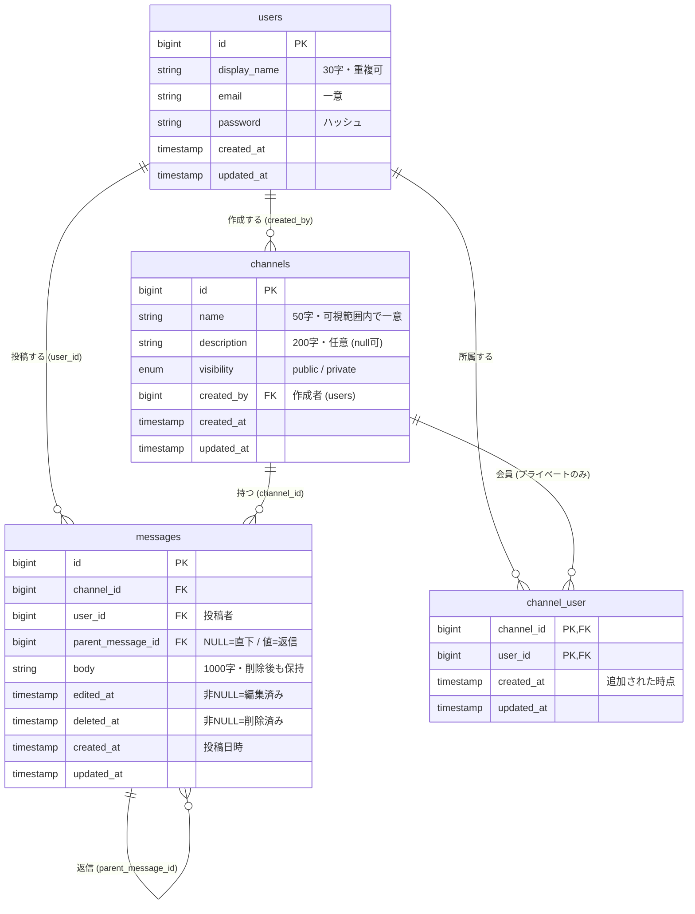

# データ設計

`docs/spec.md`（仕様書）・`mockup/`（モックアップ）・確定した `docs/design/`（`features.md`・`questions.md`・`screens.md`）をもとにした、データの設計です。ER図・テーブル定義書・CRUD表を置きます。

- 図は Markdown 内の Mermaid で書きます（README「そのほかの決まり」）。
- 根拠は spec・mockup・`docs/design/` にあるものだけに限り、書かれていないことは想像で足していません。
- クラス図は作りません。Laravel の MVC の形（Eloquent モデル＝テーブル1枚）に乗ります（README）。

---

## 0. この設計の前提

ドメインのテーブルは **4枚**です。認証の付帯テーブル（セッション等）やパスワード再設定テーブルは Laravel の土台として扱い、ここでは対象外にします（パスワード再設定は作らない＝Q-17）。

| 決めごと | 内容 | 根拠 |
|:--|:--|:--|
| メッセージと返信 | **1テーブル**（`messages`）に `parent_message_id` を持たせ、`NULL`＝チャンネル直下／値あり＝返信とする。返信は1段のみ | spec 3-5／Q-06（1段）／Q-15（直下）／16-1-4 の決定 |
| 削除の持ち方 | 行は残し `deleted_at`（削除日時）を付ける。**本文はそのまま保持**する（跡に「このメッセージは削除されました」を出すため、投稿者・日時・返信件数も行ごと残る） | spec 3-4／Q-18・16-1-4 の決定 |
| 編集済みの印 | `edited_at`（編集日時）を持ち、非 `NULL` を「編集済み」とする。時刻は画面に出さないが、`updated_at` は削除でも動くので専用列にする | spec 3-4／F-11／回答ログ（印は付いたまま）／design-guide §4 |
| 会員（`channel_user`） | **プライベートチャンネルの会員だけ**を持つ。公開チャンネルは「誰でも」なので行を作らない。作成者は該当プライベートの会員として入る | spec 3-2・3-3（56行）／F-08 |
| チャンネル名の一意 | **可視範囲内で一意**。公開名は全体で一意、プライベート名は作成者から見える範囲で重複を禁止する。DB の UNIQUE ではなくアプリ側で判定（見えない private の存在を漏らさないため） | 回答ログ（同名禁止）＋Q-01（存在を隠す）の両立／16-1-5 の決定 |
| ID・日時 | `id`（bigint・自動採番）、`created_at`（＝投稿日時／作成日時）、`updated_at` は Laravel 標準 | README（MVC の形に乗る）／spec 3-4（いつ書いたか） |

---

## 1. ER図

- `messages` の自己参照（`parent_message_id`）が「返信は元メッセージにぶら下がる」（spec 3-5）を表します。**1段のみ**（Q-06）は、親に親がない行（`parent_message_id IS NULL`）にだけ返信を付けられる、というアプリ側の制約で担保します。
- `channel_user` は users × channels の会員表で、**プライベートのみ**行を持ちます（公開は会員の概念を使わない。spec 3-3）。

---

## 2. テーブル定義書

型は Laravel のマイグレーションに素直に対応する粒度で書きます（`string`＝VARCHAR、`text`＝TEXT、`timestamp`＝TIMESTAMP）。文字数上限は spec 5-1。字数での上限はアプリ側のバリデーションで、画面の入力チェック（`screens.md` §4）と対にします。

### 2-1. `users`（社員アカウント）

| 列名 | 型 | NULL | キー・制約 | 説明 / 根拠 |
|:--|:--|:--|:--|:--|
| `id` | bigint | 不可 | PK | 自動採番（Laravel 標準） |
| `display_name` | string(30) | 不可 | | 表示名。メッセージに出る名前。重複可（Q-10）。spec 5-1＝30字 |
| `email` | string | 不可 | UNIQUE | ログインID。重複不可（Q-10／spec 3-1） |
| `password` | string | 不可 | | ハッシュ化して保存。8字以上はバリデーション（spec 5-1／3-1） |
| `created_at` | timestamp | 不可 | | 登録日時（Laravel 標準） |
| `updated_at` | timestamp | 不可 | | 更新日時（Laravel 標準） |

### 2-2. `channels`（チャンネル）

| 列名 | 型 | NULL | キー・制約 | 説明 / 根拠 |
|:--|:--|:--|:--|:--|
| `id` | bigint | 不可 | PK | 自動採番 |
| `name` | string(50) | 不可 | （DBのUNIQUEは置かない） | チャンネル名。**可視範囲内で一意**をアプリ側で判定（回答ログ＋Q-01）。spec 5-1＝50字 |
| `description` | string(200) | 可 | | 説明。任意（screens §3-8）。spec 5-1＝200字 |
| `visibility` | enum(`public`,`private`) | 不可 | | 公開範囲（spec 3-2／F-04）。作成後は変更不可（Q-02）をアプリ側で担保 |
| `created_by` | bigint | 不可 | FK→`users.id` | 作成者。編集・削除・メンバー管理の権限者（spec 3-2）。交代なし（回答ログ） |
| `created_at` | timestamp | 不可 | | 作成日時 |
| `updated_at` | timestamp | 不可 | | 更新日時 |

### 2-3. `channel_user`（プライベートチャンネルの会員：中間テーブル）

`Channel` × `User` の `belongsToMany` の既定名（2モデルを単数・スネークケースにしてアルファベット順）。**サロゲート `id` は置かず**、`(channel_id, user_id)` を複合主キーにする。日時は `withTimestamps()` で持つ。

| 列名 | 型 | NULL | キー・制約 | 説明 / 根拠 |
|:--|:--|:--|:--|:--|
| `channel_id` | bigint | 不可 | 複合PK・FK→`channels.id` | 対象チャンネル（プライベートのみ） |
| `user_id` | bigint | 不可 | 複合PK・FK→`users.id` | 会員。同じ人を二重に入れない |
| `created_at` | timestamp | 不可 | | 追加された日時。「その時点から読み書き」（spec 3-3） |
| `updated_at` | timestamp | 不可 | | 更新日時 |

- **公開チャンネルは行を持ちません**（spec 3-3・56行）。作成者はプライベートを作ると同時にこの表に入り（spec 3-2）、外せません（回答ログ）＝アプリ側で担保。

### 2-4. `messages`（メッセージ＝直下・返信の共通テーブル）

| 列名 | 型 | NULL | キー・制約 | 説明 / 根拠 |
|:--|:--|:--|:--|:--|
| `id` | bigint | 不可 | PK | 自動採番 |
| `channel_id` | bigint | 不可 | FK→`channels.id` | 所属チャンネル。返信も親と同じチャンネルを持つ（spec 3-4・3-5） |
| `user_id` | bigint | 不可 | FK→`users.id` | 投稿者（spec 3-4） |
| `parent_message_id` | bigint | 可 | FK→`messages.id` | `NULL`＝チャンネル直下／値あり＝その親への返信。1段のみ（spec 3-5／Q-06／Q-15） |
| `body` | text | 不可 | | 本文。1000字（spec 5-1）。**削除後もそのまま保持**（16-1-4 の決定） |
| `edited_at` | timestamp | 可 | | 非 `NULL`＝「編集済み」（spec 3-4／F-11） |
| `deleted_at` | timestamp | 可 | | 非 `NULL`＝「削除済み」。本文は残し、跡に定型文を出す（spec 3-4／Q-18） |
| `created_at` | timestamp | 不可 | | 投稿日時。画面の日時・日付区切りに使う（spec 3-4／screens §3-4） |
| `updated_at` | timestamp | 不可 | | 更新日時 |

- **返信件数**（spec 3-5）＝ `parent_message_id` が自分を指す行の件数。`deleted_at` で絞らず、**削除された返信も数える**（Q-16）。
- 画面での出し分け（直下では墓標を出す／検索・公開APIでは削除済みを除外する）や、検索が返信本文を対象に含めるかは**クエリの振る舞い**であり、`behavior.md`・`permissions-api.md` 側で決めます（本文の持ち方＝このテーブルには影響しません）。

---

## 3. CRUD表

機能（F-xx）を行、テーブルを列にしています。記号は **C**＝作成 / **R**＝参照 / **U**＝更新 / **D**＝物理削除。

- **R** には、その機能が表示・権限判定のために必ず読むテーブルを含めます（投稿者名・作成者名の表示、プライベートの可視判定など。根拠は `screens.md`・spec）。
- **論理削除は U** です。F-12 のメッセージ削除は `deleted_at` を付けるだけで**行は残る**ため U。**物理削除（D）が起きるのは F-07 のチャンネル削除だけ**で、中のメッセージ・返信（`messages`）と会員（`channel_user`）をまとめて消します（Q-08）。

| 機能 | `users` | `channels` | `channel_user` | `messages` |
|:--|:--:|:--:|:--:|:--:|
| F-01 新規登録 | C | | | |
| F-02 ログイン | R | | | |
| F-03 ログアウト | — | — | — | — |
| F-04 チャンネル作成 | | C | C（プライベート時） | |
| F-05 チャンネル一覧表示 | R | R | R | |
| F-06 チャンネル編集 | | U | | |
| F-07 チャンネル削除 | | D | D | D |
| F-08 メンバー管理 | R | R | C・D | |
| F-09 メッセージ一覧表示 | R | R | R | R |
| F-10 メッセージ投稿 | | | | C |
| F-11 メッセージ編集 | | | | U |
| F-12 メッセージ削除 | | | | U |
| F-13 スレッド返信 | | | | C |
| F-14 メッセージ検索 | R | R | R | R |
| F-15 公開API：公開チャンネル一覧 | | R | | |
| F-16 公開API：公開チャンネルのメッセージ一覧 | R | R | | R |

### 補足（埋めずに置いた所・読み方）

- **F-03 ログアウト**は、どのドメインテーブルにも触れません（ログインセッションの破棄のみ）。想像で埋めず、全列を「—（該当なし）」のまま置いています。
- F-04 の `channel_user` は **C（プライベート時）**。公開チャンネルの作成では会員行を作りません（§2-3）。
- F-08 の `channel_user` は **C・D**（追加・削除）。作成者の行は外せません（回答ログ）＝アプリ側。
- F-15・F-16 の `users` 参照は、公開APIが**投稿者を表示名のみ**で返すため（Q-14）。メール等は含めません。F-16 の `messages` R は、削除済みを除外し、返信は本文に含めず件数だけにする（Q-14・Q-15）＝ `permissions-api.md` 側で定義。
