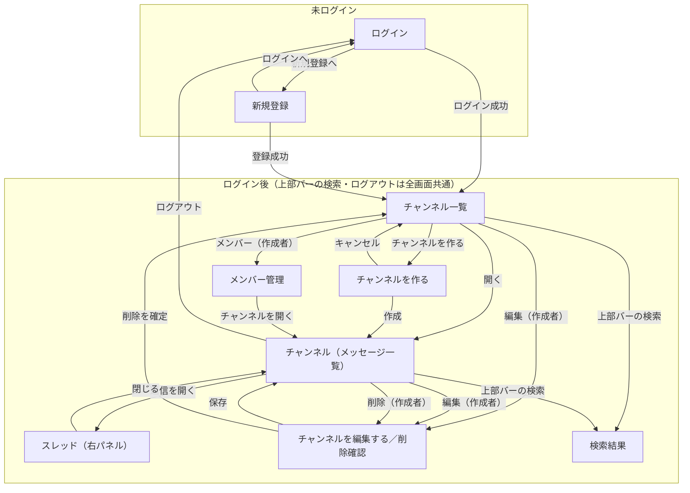

# 画面設計

`mockup/` の9画面と `docs/spec.md`、確定した `questions.md` をもとにした、画面まわりの設計です。

- 見た目の細部は `mockup/` と `mockup/design-guide.md` が正。ここでは**並び・項目・言葉づかい・状態の見せ方**と、**入力チェック**を決めます。
- 画面項目定義は **主要画面だけ**書きます。同じ形の繰り返しは「◯◯と同じ」で済ませます（README の「書く量の決まり」）。
- `mockup/index.html` は見本をめぐるためのカタログで、アプリの画面ではありません。
- 公開API（F-15・F-16）は画面を持たないため、この文書では扱いません（→ `permissions-api.md`）。

---

## 1. 画面一覧

| 画面 | 見本ファイル | 役割 | 見られる人 |
|:--|:--|:--|:--|
| ログイン | `login.html` | メール＋パスワードで入る | 未ログイン |
| 新規登録 | `register.html` | アカウントを作る | 未ログイン |
| チャンネル一覧 | `channels.html` | 見られるチャンネルを並べる・作成へ | ログイン社員 |
| チャンネル（メッセージ一覧） | `channel-show.html` | メッセージを読む・投稿する | そのチャンネルを見られる社員 |
| スレッド | `thread.html` | 1つのメッセージの返信を読む・返信する（右パネル） | 同上 |
| 検索結果 | `search.html` | キーワードでメッセージを探す（0件表示あり） | ログイン社員 |
| メンバー管理 | `members.html` | プライベートチャンネルのメンバー追加・削除 | そのチャンネルの作成者のみ |
| チャンネルを作る | `channel-new.html` | 名前・説明・公開範囲を決めて作る | ログイン社員 |
| チャンネルを編集する／削除確認 | `channel-edit.html` | 名前・説明を直す／チャンネルを消す | そのチャンネルの作成者のみ |

ログイン後に最初に開く画面は**チャンネル一覧**（Q-11）。未ログインで入れるのはログイン・新規登録のみ。

---

## 2. 画面遷移図

- **上部バー**（メッセージ検索・ログイン中の氏名・ログアウト）と**サイドバー**は、ログイン後の全画面に共通。遷移図では代表の線だけ引いています。
- 検索はどのログイン後画面からでも上部バーで開けます。
- 見る権利のないチャンネル（自分がメンバーでないプライベート）へは、リンク自体を出しません（Q-01）。URL を直接たたいた場合の扱いは例外方針として `behavior.md` で決めます。

---

## 3. 画面項目定義（主要画面）

### 3-0. 共通部品（ログイン後の全画面）

| 区画 | 項目 | 備考 |
|:--|:--|:--|
| 上部バー | アプリ名「チームチャットアプリ」／メッセージ検索（押すと検索画面）／ログイン中の表示名／ログアウト | spec 5-3（名称統一） |
| サイドバー | 見出し「チャンネル」／見られるチャンネルの一覧（公開は `#`、プライベートは鍵アイコン）／選択中はハイライト／「チャンネル一覧を見る」リンク | 一覧の範囲は Q-01 |

### 3-1. 新規登録（`register.html`）

| 項目 | 種類 | 必須 | 補足 |
|:--|:--|:--|:--|
| 表示名 | テキスト | ○ | 文字数カウンタ `n / 30`。補足「メッセージに表示される名前です。」 |
| メールアドレス | テキスト | ○ | ログインに使う |
| パスワード | パスワード | ○ | 補足「8文字以上で入力してください。」 |
| パスワード（確認用） | パスワード | ○ | 上と一致（Q-09） |
| 登録する | ボタン（主） | – | 横幅いっぱい・高さ44px |
| ログインへのリンク | リンク | – | 「すでにアカウントをお持ちの方は ログイン」 |

### 3-2. ログイン（`register.html` の項目を絞ったもの）

- 項目：メールアドレス／パスワード／「ログイン」ボタン（主・横幅いっぱい）／「新規登録」リンク。
- 認証失敗時は欄ごとではなく**フォーム全体に1つ**エラーを出す（下表）。

### 3-3. チャンネル一覧（`channels.html`）

| 区画 | 項目 | 備考 |
|:--|:--|:--|
| 見出し | 「チャンネル一覧」＋補足文／「チャンネルを作る」ボタン（主） | |
| 一覧の各行 | `#`／鍵 ＋ チャンネル名 ＋ 公開/プライベートのバッジ ／ 説明・作成者 ／ 操作ボタン | |
| 操作ボタン | 「開く」は常時。「編集」「メンバー」は**作成者のときだけ**（「メンバー」はプライベートのみ） | spec 3-2・3-3 |

### 3-4. チャンネル（メッセージ一覧）（`channel-show.html`）― 中心画面

| 区画 | 項目 | 備考 |
|:--|:--|:--|
| チャンネルヘッダ | `#`／鍵 ＋ 名前 ／ バッジ ／ 説明 ／（作成者のみ）編集・削除ボタン | |
| 日付の区切り | 「2026年8月17日（月）」 | 自分で決めたこと（日付区切り） |
| メッセージ | アバター（頭文字＋固定色）／ 投稿者名 ／ 日時 `2026/08/17 14:32` ／ 本文 | design-guide §1・§2 |
| ― 編集済み | 本文末尾に小さく「編集済み」 | spec 3-4 |
| ― 削除済み | 本文の代わりに「このメッセージは削除されました」。投稿者・日時・返信件数は残す | spec 3-4／design-guide §4／Q-18（見え方のみ確定） |
| ― 返信あり | 本文下に「返信n件」リンク（スレッドを開く） | spec 3-5 |
| ― ホバー操作 | 行の右上に 返信／編集／削除。編集・削除は**自分のメッセージだけ**に出す | spec 3-4／Q-07 |
| 投稿欄 | テキスト入力（プレースホルダ「#開発 にメッセージを送る」）／ 文字数カウンタ ／ 送信ボタン | |

- 並びは**古い順**、**100件ごとのページング**で表示（Q-12）。
- 他人のメッセージには編集・削除を出さない。作成者でも他人のメッセージは操作不可（Q-07）。

### 3-5. スレッド（`thread.html`）― メッセージ部は 3-4 と同じ

- 右側に固定幅のパネル。ヘッダ（「スレッド」＋対象チャンネル＋閉じる）。
- 中身：**元メッセージ** → 「返信n件」→ **返信の一覧**（1件ずつの見せ方は 3-4 のメッセージと同じ）。
- 返信の投稿欄（プレースホルダ「返信を送る」）。
- 返信は**1段だけ**。返信に対する返信は作らない（Q-06）。
- 元メッセージが**削除済みでも、返信は残り、スレッドは開けて返信も続けられる**（回答ログ：削除済みへの返信は継続可）。

### 3-6. メンバー管理（`members.html`）

| 区画 | 項目 | 備考 |
|:--|:--|:--|
| 見出し | チャンネル名＋プライベートバッジ＋補足／「チャンネルを開く」ボタン | |
| 追加カード | 入力「表示名またはメールアドレスで探す」＋「追加」ボタン | 完全一致・既存社員のみ（Q-13） |
| メンバー一覧 | アバター／氏名（作成者は「作成者」バッジ）／メール／「外す」ボタン | |
| ― 作成者の行 | 「外す」は無効（`disabled`）。横に「作成者は外せません」 | 回答ログ：作成者は外れられない |

- この画面を開けるのは**プライベートチャンネルの作成者だけ**。公開チャンネルにメンバー管理はない（spec 3-3）。

### 3-7. チャンネルを作る（`channel-new.html`）

| 項目 | 種類 | 必須 | 補足 |
|:--|:--|:--|:--|
| チャンネル名 | テキスト | ○ | カウンタ `n / 50` |
| 説明 | テキスト（複数行） | – | カウンタ `n / 200`。補足「何について話す場所かを短く書きます。」 |
| 公開範囲 | ラジオ（公開／プライベート） | ○ | 初期選択は「公開」。各選択肢に説明文 |
| 作成する／キャンセル | ボタン | – | 「作成する」は主ボタン |

### 3-8. チャンネルを編集する／削除確認（`channel-edit.html`）― フォームは 3-7 と同じ

- **差分①**：公開範囲のラジオは**出さない**。代わりに補足「公開チャンネルです。公開範囲はあとから変更できません。」（Q-02）。
- **差分②**：下に「チャンネルを削除する」区画（赤枠）。「削除する」ボタンを押すと確認カードを表示：
  - 問い「『開発』を削除しますか？」／ 影響「メッセージ n件と返信 m件も削除されます。この操作は取り消せません」／ **チャンネル名の入力**／「やめる」「削除する（塗りの赤）」。
  - 確定でチャンネルと中のメッセージ・返信をすべて削除（Q-08）。

### 3-9. 検索結果（`search.html`）

| 区画 | 項目 | 備考 |
|:--|:--|:--|
| 検索入力 | キーワード入力＋「検索」ボタン | |
| 件数 | 「『リリース』の検索結果　n件」 | |
| 結果の各行 | チャンネル名（`#`／鍵）／投稿者／日時 ／ 本文（一致語を `mark` で強調） | |
| 0件 | 空状態「『◯◯』に一致するメッセージはありません」＋次の一手 | design-guide §4 |

- 対象は**自分が見られるチャンネルのメッセージ本文のみ**（spec 3-6／Q-04）。自分がメンバーでないプライベートの内容は絶対に出さない。
- 削除済みメッセージは結果に出さない（Q-05）。検索はログイン必須（回答ログ）。

---

## 4. 入力チェックとメッセージ

共通の決まり（design-guide §4）：エラー文は**1文・句点なし**、文頭に赤い丸の `!`、欄の枠と地を赤に、フォーカスリングも赤。文字数は字数で数え（全角・半角を区別しない）、カウンタは入力に追随させ、上限超過は赤で示す（自分で決めたこと）。

| 画面 | 項目 | ルール | エラー文（例） |
|:--|:--|:--|:--|
| 新規登録 | 表示名 | 必須・30文字以内 | 表示名を入力してください ／ 表示名は30文字以内で入力してください |
| 新規登録 | メールアドレス | 必須・メール形式・重複不可 | メールアドレスを入力してください ／ メールアドレスの形式が正しくありません ／ このメールアドレスは登録済みです |
| 新規登録 | パスワード | 必須・8文字以上 | パスワードを入力してください ／ パスワードは8文字以上で入力してください |
| 新規登録 | パスワード（確認用） | 必須・パスワードと一致 | 確認用のパスワードが一致しません |
| ログイン | メール／パスワード | 認証失敗はフォーム全体に1つ | メールアドレスまたはパスワードが正しくありません |
| チャンネル作成／編集 | チャンネル名 | 必須・50文字以内・同名不可 | チャンネル名を入力してください ／ チャンネル名は50文字以内で入力してください ／ 同じ名前のチャンネルがすでにあります |
| チャンネル作成／編集 | 説明 | 任意・200文字以内 | 説明は200文字以内で入力してください |
| チャンネル作成 | 公開範囲 | 必須（初期＝公開） | （既定で選択済みのため通常は出ない） |
| メッセージ投稿／編集 | 本文 | 必須（空送信不可）・1,000文字以内 | メッセージを入力してください ／ メッセージは1,000文字以内で入力してください |
| 検索 | キーワード | 必須 | 検索するキーワードを入力してください |
| メンバー管理 | 追加する人 | 必須・該当する既存社員がいる・まだメンバーでない | 追加する人を入力してください ／ その表示名またはメールアドレスの人は見つかりません ／ すでにメンバーです |
| チャンネル削除確認 | チャンネル名の入力 | 対象のチャンネル名と一致 | チャンネル名が一致しません |

- 「同じ名前のチャンネルがすでにあります」は、クライアント回答（同名チャンネル禁止）に基づく（`questions.md` 回答ログ）。
- 本文・チャンネル名などの上限超過は、送信前にカウンタが赤くなり、送信時にも上表のエラーで止める。
