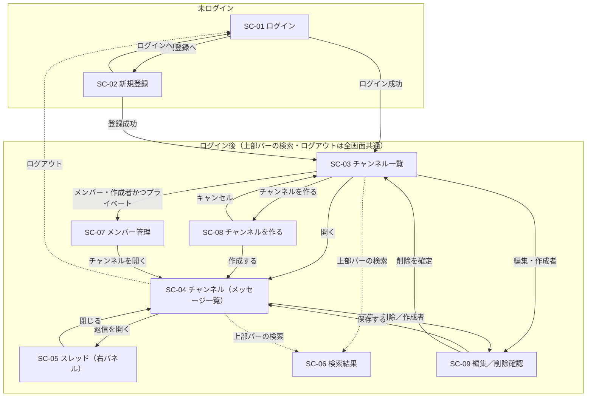

# 画面設計

`mockup/` の9画面（`index.html` はカタログなので除く）と `docs/spec.md`、確定した `questions.md` をもとにした、画面まわりの設計です。

- 見た目の細部は `mockup/` と `mockup/design-guide.md` が正。ここで決めるのは **並び・項目・言葉づかい・状態の見せ方** と **入力チェック** です。ピクセル単位の一致は求めません（spec 5-3）。
- 根拠は `mockup/`・`spec.md`・`docs/design/`（`features.md`・`questions.md`）にあるものだけに限り、書かれていないことは足していません。
- 文字数の上限は `spec.md 5-1` の値、エラー文の言い回しはモックアップに合わせています（根拠は §4 冒頭）。
- 公開API（F-15・F-16）は画面を持たないため、この文書では扱いません（→ `permissions-api.md`）。
- URL を直接たたいたときなど、権限のない画面に入ろうとした場合の扱いは例外方針として `behavior.md` で決めます。

---

## 1. 画面一覧

`index.html`（カタログ）を除く9画面に SC-01 から連番を振ります。

| ID | 画面 | 見本ファイル | 役割 | 見られる人 |
|:--|:--|:--|:--|:--|
| SC-01 | ログイン | `login.html` | メール＋パスワードで入る | 未ログイン |
| SC-02 | 新規登録 | `register.html` | アカウントを作る | 未ログイン |
| SC-03 | チャンネル一覧 | `channels.html` | 見られるチャンネルを並べる・作成/編集/メンバーへ入る | ログイン社員 |
| SC-04 | チャンネル（メッセージ一覧） | `channel-show.html` | メッセージを読む・投稿する・編集/削除する | そのチャンネルを見られる社員 |
| SC-05 | スレッド | `thread.html` | 1つのメッセージの返信を読む・返信する（右パネル） | 同上 |
| SC-06 | 検索結果 | `search.html` | キーワードでメッセージを探す（0件表示あり） | ログイン社員 |
| SC-07 | メンバー管理 | `members.html` | プライベートチャンネルのメンバー追加・削除 | そのチャンネルの作成者のみ |
| SC-08 | チャンネルを作る | `channel-new.html` | 名前・説明・公開範囲を決めて作る | ログイン社員 |
| SC-09 | チャンネルを編集する／削除確認 | `channel-edit.html` | 名前・説明を直す／チャンネルを消す | そのチャンネルの作成者のみ |

- ログイン後に最初に開く画面は **SC-03 チャンネル一覧**（Q-11）。
- 未ログインで入れるのは SC-01・SC-02 のみ。それ以外はログインが要る（spec 2・3）。
- SC-03/04/06/07/08/09 には **上部バー** と **サイドバー** が付く（SC-05 は SC-04 の右にパネルを足した形）。共通部品は §3-0 に一度だけ定義します。

---

## 2. 画面遷移図

- **上部バー**（メッセージ検索・ログイン中の氏名・ログアウト）と **サイドバー** は、ログイン後の全画面に共通。遷移図では代表の線（点線）だけ引いています。検索とログアウトはどのログイン後画面からでも上部バーで行えます。
- 見る権利のないチャンネル（自分がメンバーでないプライベート）へは、サイドバー・一覧ともに **リンク自体を出しません**（Q-01）。
- SC-07 メンバー・SC-09 編集 へ入る導線は、作成者にだけ出します（SC-09 の削除も同じ）。SC-07 は **プライベートの作成者だけ**（spec 3-3）。

---

## 3. 画面項目定義

### 書く範囲と、その理由

全画面ぶんは書きません（README「書く量の決まり」）。**新しい項目・状態・権限による出し分け・入力チェックが初めて出てくる画面だけ**を主要画面として詳しく書き、同じ形の繰り返しは「◯◯と同じ」で差分だけ示します。選んだ基準は「あとから実装する人が、その画面を組むのに判断材料として要るか」です。

| 区分 | 画面 | 扱い | なぜそうしたか |
|:--|:--|:--|:--|
| 詳しく書く | SC-02 新規登録 | フル | 入力項目・必須・カウンタ・確認用パスワードが最初に出る。認証フォームの代表 |
| 詳しく書く | SC-03 チャンネル一覧 | フル | 一覧行の構成と、**作成者かどうか・公開/プライベートで操作ボタンを出し分ける**判断がここで決まる |
| 詳しく書く | SC-04 チャンネル（メッセージ一覧） | フル | アプリの中心。メッセージの通常／編集済み／削除済み／返信あり／ホバー操作と投稿欄が全部出る |
| 詳しく書く | SC-08 チャンネルを作る | フル | 名前・説明・公開範囲の入力フォームの代表 |
| 差分だけ | SC-01 ログイン | SC-02 の項目を絞る | 新規登録の部分集合。差分と認証エラーだけ |
| 差分だけ | SC-05 スレッド | メッセージ部は SC-04 と同じ | 右パネルの枠（ヘッダ・元メッセージ・件数・返信投稿欄）だけが新しい |
| 差分だけ | SC-09 編集／削除確認 | フォームは SC-08 と同じ | 公開範囲を出さない点と、削除確認の区画だけが新しい |
| 要点だけ | SC-06 検索結果 | 要点 | 一覧＋0件表示。項目は少なく、結果行と空状態を押さえれば足りる |
| 要点だけ | SC-07 メンバー管理 | 要点 | 追加フォームと一覧。作成者の行だけ「外す」を無効にする点が肝 |

### 3-0. 共通部品（ログイン後の全画面）

| 区画 | 項目 | 備考 |
|:--|:--|:--|
| 上部バー | ロゴ記号「チ」＋アプリ名「チームチャットアプリ」／「メッセージを検索」（押すと SC-06）／ログイン中の表示名／「ログアウト」 | 名称は統一（spec 5-3）。高さ 52px 固定（design-guide §3） |
| サイドバー | グループ見出し「チャンネル」／見られるチャンネルの行（公開は `#`、プライベートは鍵アイコン＋チャンネル名）／選択中はハイライト／末尾に「チャンネル一覧を見る」リンク | 並べる範囲は公開すべて＋自分がメンバーのプライベートだけ（Q-01）。幅 260px 固定 |

### 3-1. SC-02 新規登録（`register.html`）

| 項目 | 種類 | 必須 | 補足（モックの文言） |
|:--|:--|:--|:--|
| 表示名 | テキスト | ○ `*` | 補足「メッセージに表示される名前です。」／カウンタ `n / 30` |
| メールアドレス | テキスト | ○ `*` | ログインに使う（重複不可：Q-10） |
| パスワード | パスワード | ○ `*` | 補足「8文字以上で入力してください。」 |
| パスワード（確認用） | パスワード | ○ `*` | 上と一致を検証（Q-09） |
| 登録する | ボタン（主・横幅いっぱい・高さ44px） | – | design-guide §3（`--ctl-h-lg`） |
| ログインへのリンク | リンク | – | 「すでにアカウントをお持ちの方は ログイン」 |

- カード幅 420px（`--form-max`）。必須項目はラベル右に赤い `*`。
- 登録に招待・承認は要らない（回答ログ）。登録成功後は SC-03 へ。

### 3-2. SC-01 ログイン（`login.html`）― 項目は SC-02 を絞ったもの

- 項目：メールアドレス／パスワード／「ログイン」ボタン（主・横幅いっぱい・高さ44px）／「アカウントをお持ちでない方は 新規登録」リンク。
- 認証失敗は欄ごとに分けず **1つだけ** 出す。モックではパスワード欄の下に「メールアドレスまたはパスワードが正しくありません」を出している（§4）。

### 3-3. SC-03 チャンネル一覧（`channels.html`）

| 区画 | 項目 | 備考 |
|:--|:--|:--|
| 見出し | タイトル「チャンネル一覧」＋補足「公開チャンネルは、ログインしている社員なら誰でも読み書きできます。」／「チャンネルを作る」ボタン（主） | |
| 一覧の各行 | 記号（`#`／鍵）＋チャンネル名＋バッジ（公開／プライベート）／サブ行「説明　·　作成者：氏名」／操作ボタン | バッジの色は design-guide §1（公開＝藍、プライベート＝注意色） |
| 操作ボタン | 「開く」は常時。「編集」は **作成者のときだけ**。「メンバー」は **プライベートの作成者のときだけ** | spec 3-2・3-3。並び順はモックどおり（メンバー→編集→開く） |

- 並べるチャンネルの範囲は §3-0 のとおり（Q-01）。自分がメンバーでないプライベートは行自体を出さない。

### 3-4. SC-04 チャンネル（メッセージ一覧）（`channel-show.html`）― 中心画面

| 区画 | 項目 | 備考 |
|:--|:--|:--|
| チャンネルヘッダ | 記号（`#`／鍵）＋名前／バッジ／説明／（作成者のみ）「編集」「削除」ボタン | 「削除」は赤字ボタン。他人には出さない |
| 日付の区切り | 「2026年8月17日（月）」 | `day-sep`（自分で決めたこと：日付区切り） |
| メッセージ（通常） | アバター（頭文字＋人ごとに固定色）／投稿者名／日時 `2026/08/17 09:12`／本文 | design-guide §1・§2。並びは **古い順**、**100件ごとのページング**（Q-12） |
| ― 編集済み | 本文末尾に小さく「編集済み」 | spec 3-4。体裁は本文のまま（design-guide §4） |
| ― 削除済み | 本文の代わりに破線枠で「このメッセージは削除されました」。投稿者名・日時・返信件数は残す | spec 3-4／design-guide §4／Q-18（見え方のみ確定） |
| ― 返信あり | 本文の下にリンク「返信n件」（押すと SC-05 を開く） | spec 3-5。削除済みメッセージでも返信件数は残す（Q-16） |
| ― ホバー操作 | 行の右上に小さな枠で「返信／編集／削除」。**編集・削除は自分のメッセージだけ**に出す | spec 3-4／Q-07。作成者でも他人のメッセージは操作不可 |
| 投稿欄 | テキスト入力（プレースホルダ「#開発 にメッセージを送る」＝`#チャンネル名 にメッセージを送る`）／カウンタ `0 / 1,000 文字`／「送信」ボタン | |

- メッセージを編集中は、本文のあった場所が入力欄に変わり、下に「保存」「やめる」を横並びに出す（design-guide §4「編集中」）。
- 削除は1件ずつ即時（確認なし）。跡に「このメッセージは削除されました」を残す（Q-08）。チャンネルごとの削除とは分ける。

### 3-5. SC-05 スレッド（`thread.html`）― メッセージ部は SC-04 と同じ

- 画面右に固定幅 400px のパネル（`--thread-w`）。中央の一覧（SC-04）はそのまま残る。
- パネルの構成：ヘッダ（「スレッド」＋対象チャンネル `#名前`＋「閉じる」）→ **元メッセージ**（1件、SC-04 のメッセージと同じ見せ方）→ 「返信n件」→ **返信の一覧**（各1件も SC-04 と同じ）→ 返信の投稿欄（プレースホルダ「返信を送る」／カウンタ `0 / 1,000 文字`／「送信」）。
- 返信は **1段だけ**。返信への返信は作らない（Q-06）。
- 元メッセージが **削除済みでも、返信は残り、スレッドは開けて返信も続けられる**（回答ログ：削除済みへの返信は継続可）。モックの元メッセージも削除済みの状態で返信3件が付いている。

### 3-6. SC-06 検索結果（`search.html`）

| 区画 | 項目 | 備考 |
|:--|:--|:--|
| タイトル | 「メッセージを検索」 | |
| 検索入力 | キーワード入力＋「検索」ボタン（主） | |
| 件数 | 「『リリース』の検索結果　n件」 | 全角スペースの表記もモックどおり |
| 結果の各行 | メタ（チャンネル `#`／鍵 ＋名前　·　投稿者　·　日時）／本文（一致語を `mark` で黄色強調） | |
| 0件 | 空状態「『◯◯』に一致するメッセージはありません」＋次の一手「別のキーワードで試すか、キーワードを短くしてください。」 | design-guide §4「空・0件」 |

- 対象は **自分が見られるチャンネルのメッセージ本文のみ**（spec 3-6／Q-04）。メンバーでないプライベートの内容は絶対に出さない。
- 削除済みメッセージは結果に出さない（Q-05）。検索はログイン必須（回答ログ）。

### 3-7. SC-07 メンバー管理（`members.html`）

| 区画 | 項目 | 備考 |
|:--|:--|:--|
| 見出し | 鍵＋チャンネル名＋プライベートバッジ／補足「説明　·　追加された人だけが読み書きできます。」／「チャンネルを開く」ボタン | |
| 追加カード | 見出し「メンバーを追加する」／入力（プレースホルダ「表示名またはメールアドレスで探す」）＋「追加」ボタン | 完全一致・既存社員のみ（Q-13）。未登録の人の招待はしない |
| メンバー一覧 | 見出し「メンバー　n人」／各行：アバター／氏名（作成者は「作成者」バッジ）／メールアドレス／「外す」ボタン | |
| ― 作成者の行 | 「外す」は無効（`disabled`）。横に補足「作成者は外せません」 | 回答ログ：作成者は外れられない。非表示にはしない（design-guide §4） |

- 開けるのは **プライベートチャンネルの作成者だけ**。公開チャンネルにメンバー管理はない（spec 3-3）。

### 3-8. SC-08 チャンネルを作る（`channel-new.html`）

| 項目 | 種類 | 必須 | 補足（モックの文言） |
|:--|:--|:--|:--|
| チャンネル名 | テキスト | ○ `*` | カウンタ `n / 50` |
| 説明 | テキスト（複数行） | – | 補足「何について話す場所かを短く書きます。」／カウンタ `n / 200` |
| 公開範囲 | ラジオ（公開／プライベート） | ○ | 初期選択「公開」。公開＝「ログインしている社員なら誰でも読み書きできます。」／プライベート＝「追加された人だけが読み書きできます。作成者がメンバーを管理します。」 |
| 作成する／キャンセル | ボタン | – | 「作成する」は主ボタン。「キャンセル」で SC-03 へ |

- 作成した人は自動でそのチャンネルのメンバーになる（spec 3-2）。作成後は SC-04 へ。

### 3-9. SC-09 チャンネルを編集する／削除確認（`channel-edit.html`）― フォームは SC-08 と同じ

- **差分①**：公開範囲のラジオは **出さない**。チャンネル名欄の補足を「公開チャンネルです。公開範囲はあとから変更できません。」にする（プライベートなら相当の文言）。ボタンは「保存する」（Q-02）。
- **差分②**：フォームの下に「チャンネルを削除する」区画（赤枠）。
  - 最初の表示：「このチャンネルを削除します」＋「メッセージと返信もすべて削除され、元に戻せません。」＋「削除する」ボタン。
  - 押すと確認カード：問い「『開発』を削除しますか？」／影響「メッセージ n件と返信 m件も削除されます。この操作は取り消せません。確認のためチャンネル名を入力してください。」／**チャンネル名の入力欄**／「やめる」「削除する（塗りの赤）」。
  - 確定でチャンネルと中のメッセージ・返信をすべて削除し、SC-03 へ（Q-08）。1件のメッセージ削除（跡を残す）とは扱いが違う。

---

## 4. 入力チェックとエラーメッセージ

**言い回しの根拠**：モックに文言が出ているのは SC-01 の「メールアドレスまたはパスワードが正しくありません」と SC-08 の「チャンネル名を入力してください」の2つ。この2つと design-guide §4 の作法（**1文・句点なし**、文頭に赤い丸の `!`、欄の枠と地を赤に、フォーカスリングも赤）に合わせて、ほかのエラー文も「〜を入力してください」「〜が正しくありません」の形で揃えています。

**文字数の上限**は `spec.md 5-1`：表示名30／チャンネル名50／説明200／メッセージ1,000／パスワード8文字以上（上限なし）。字数で数え、全角・半角は区別しない。カウンタは入力に追随させ、上限超過は赤で示す（自分で決めたこと）。表記はモックどおり、フォーム欄は `5 / 30` 形式、メッセージ投稿欄は `0 / 1,000 文字` 形式。

| 画面 | 項目 | ルール | エラー文（例） |
|:--|:--|:--|:--|
| SC-02 新規登録 | 表示名 | 必須・30文字以内 | 表示名を入力してください ／ 表示名は30文字以内で入力してください |
| SC-02 新規登録 | メールアドレス | 必須・メール形式・重複不可 | メールアドレスを入力してください ／ メールアドレスの形式が正しくありません ／ このメールアドレスは登録済みです |
| SC-02 新規登録 | パスワード | 必須・8文字以上 | パスワードを入力してください ／ パスワードは8文字以上で入力してください |
| SC-02 新規登録 | パスワード（確認用） | 必須・パスワードと一致 | 確認用のパスワードが一致しません |
| SC-01 ログイン | メール／パスワード | 認証失敗は項目ごとに分けず1つだけ | メールアドレスまたはパスワードが正しくありません |
| SC-08/09 チャンネル作成・編集 | チャンネル名 | 必須・50文字以内・同名不可 | チャンネル名を入力してください ／ チャンネル名は50文字以内で入力してください ／ 同じ名前のチャンネルがすでにあります |
| SC-08/09 チャンネル作成・編集 | 説明 | 任意・200文字以内 | 説明は200文字以内で入力してください |
| SC-08 チャンネル作成 | 公開範囲 | 必須（初期＝公開） | （既定で選択済みのため通常は出ない） |
| SC-04/05 メッセージ投稿・返信（新規に書く） | 本文 | 必須（空送信不可）・1,000文字以内 | メッセージを入力してください ／ メッセージは1,000文字以内で入力してください |
| SC-04/05 メッセージ・返信のその場編集（書き換える） | 本文 | 必須（空にして保存できない）・1,000文字以内 | メッセージを入力してください ／ メッセージは1,000文字以内で入力してください |
| SC-06 検索 | キーワード | 必須 | 検索するキーワードを入力してください |
| SC-07 メンバー管理 | 追加する人 | 必須・該当する既存社員がいる・まだメンバーでない | 追加する人を入力してください ／ その表示名またはメールアドレスの人は見つかりません ／ すでにメンバーです |
| SC-09 チャンネル削除確認 | チャンネル名の入力 | 対象のチャンネル名と一致 | チャンネル名が一致しません |

- **空かどうかの判定は、前後の空白と改行を取り除いてから見る**（空白や改行だけの入力は空として扱い、送れない・保存できない）。これは必須の項目すべてに共通。メッセージの「新規に書く」と「その場編集」は、空・上限超過のチェックを同じ内容でかける。
- 「同じ名前のチャンネルがすでにあります」は、同名チャンネル禁止というクライアント回答に基づく（`questions.md` 回答ログ）。
- 本文・チャンネル名などの上限超過は、送信前にカウンタが赤くなり、送信時にも上表のエラーで止める。
- 空のままの送信・長すぎる入力は、使う人が困らないよう、どの項目が・なぜ駄目かを欄の下に出す（spec 5-1）。
